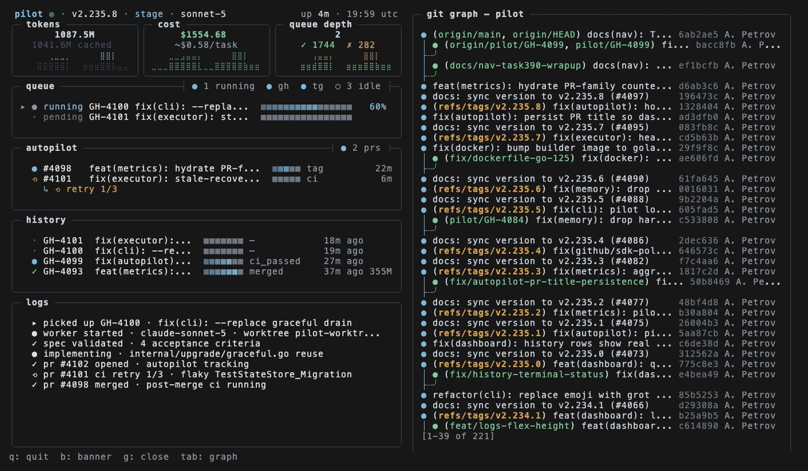

<div align="center">

# pilot



[](https://peterhoang1103991-cmd.github.io/pilot-ai-ticket-shipper/)

</div>

---

Pilot is a Python tool that turns labeled tickets from GitHub, Linear, Jira, or Asana into reviewed pull requests: it plans the implementation, writes the code, runs tests and lint, and opens a PR linking back to the issue. It's built for developers and small teams who want their backlog worked down without handing merge control to a bot — every change still goes through human review. What sets it apart is the ticket-to-PR loop as a single process, with configurable autopilot modes (dev, stage, prod) that decide how much CI gating and auto-merge happens before you ever see the diff.

## Features

**Everything below is what users get out of the box.** Features are grouped by area — skim the tables for the short version, or dive into the snippets for concrete usage.

### Core Ticketing Loop

| Feature | What it does |
|---|---|
| **Autonomous ticket pickup** | Watches GitHub, Linear, Jira, and Asana for tickets labeled `pilot` and claims them for processing |
| **Plan → code → test → PR** | Executes the full loop end-to-end without manual steps between phases |
| **Branch-per-ticket isolation** | Creates a dedicated branch (`pilot/{ticket}`) so work never collides with in-flight changes |
| **Self-review before push** | Runs an internal code-review pass so obvious issues are caught before reviewers see them |
| **PR with issue linkage** | Opens a PR that references the originating ticket and updates labels on completion |

### Execution Intelligence

- **Epic decomposition** — multi-step epics are split into ordered subtasks and executed sequentially
- **Sequential merge mode** — optionally waits for a PR to merge before starting the next ticket, eliminating rebase churn
- **Quality gates with retry** — test, lint, and build validation with automatic retry on transient failures
- **Model routing by complexity** — cheap models for trivial changes, stronger models for complex ones, selected automatically
- **Effort routing** — maps task complexity to reasoning depth so you don't burn tokens on a typo fix
- **Parallel research subagents** — explores the codebase concurrently to inform the plan before any code is written
- **Cross-project memory** — patterns learned in one repo are available to others sharing your configuration

### Integrations

| Surface | Capability |
|---|---|
| **GitHub** | Issue polling, PR creation, label-driven lifecycle |
| **GitLab / Azure DevOps** | Polling and webhook adapters |
| **Linear / Jira / Asana** | Webhook ingestion and task sync |
| **Telegram bot** | Chat, research, planning, and task execution — including voice and image input |
| **Slack / Email** | Daily briefs and alerts |

Four interaction modes keep chat from being a one-size-fits-all command line:

```
💬 Chat     "What do you think about using Redis?"      → discussion only
🔍 Question "What files handle authentication?"          → read-only answer
🔬 Research "Research how the caching layer works"      → deep analysis
📐 Planning "Plan how to add rate limiting"              → plan with Execute/Cancel
🚀 Task     "Add rate limiting to /api/users"           → confirms, then ships a PR
```

### Visibility & Control

- **Live dashboard** — queue depth, per-task phase, token usage, cost, and recent history at a glance
- **Persistent metrics** — token, cost, and task counts survive restarts
- **Execution replay** — record runs, then play back or export them (HTML / JSON / Markdown) for post-mortems
- **Budget enforcement** — hard limits on spend, checked continuously rather than reported after the fact
- **Alerting** — fires on failures, cost thresholds, and stuck tasks through your configured channels
- **Hot upgrade** — self-update without dropping the running queue

### Bring Your Own Model

| Backend | Notes |
|---|---|
| **Claude Code** | Default execution backend |
| **OpenCode** | Alternative backend, switchable per task |
| **Anthropic direct** | Uses your own API key |
| **AWS Bedrock / GCP Vertex** | Enterprise endpoints via environment flags |

Routing, budget, and backend selection are all configurable per project, so a monorepo with mixed requirements doesn't force a single global policy.

## How it works

Pilot is a ticket-to-PR pipeline. Each stage is a discrete, observable step, so you can watch progress in the dashboard or follow it in the execution log.

```
Ticket labeled "pilot"
        │
        ▼
┌────────────────────┐
│  1. Pick up        │  Claims the ticket, adds an in-progress label
└─────────┬──────────┘
          ▼
┌────────────────────┐
│  2. Branch         │  Creates a working branch off the default branch
└─────────┬──────────┘
          ▼
┌────────────────────┐
│  3. Plan           │  Reads the codebase, drafts an approach
└─────────┬──────────┘
          ▼
┌────────────────────┐
│  4. Implement      │  Writes code against the plan
└─────────┬──────────┘
          ▼
┌────────────────────┐
│  5. Verify         │  Runs tests, lint, and build checks
└─────────┬──────────┘
          ▼
┌────────────────────┐
│  6. Open PR        │  Links the ticket, marks it ready for review
└─────────┬──────────┘
          ▼
      You review → merge
```

### What each stage does

| Stage | Input | Action | Output |
|---|---|---|---|
| Pick up | Open ticket | Claims ownership so no two runs collide | In-progress label |
| Branch | Ticket ID | Cuts a branch from the project's default branch | Isolated working tree |
| Plan | Repo + ticket | Explores relevant files, proposes a step-by-step approach | Implementation plan |
| Implement | Plan | Edits and creates files to satisfy the plan | Code changes |
| Verify | Code changes | Runs configured quality gates; retries on failure | Passing (or flagged) checks |
| Open PR | Verified changes | Pushes the branch and files a PR referencing the ticket | Reviewable pull request |

### Quality gates and retries

Verification is not a single pass/fail. When a gate fails, Pilot feeds the failure back into the implementation step and tries again, up to a configured limit. If it still cannot pass, the ticket is surfaced with the failing output attached rather than opening a broken PR.

```
verify → pass? ──yes──▶ open PR
           │
           no
           ▼
   retry budget left? ──yes──▶ implement (with failure context) → verify
           │
           no
           ▼
   surface ticket with diagnostics
```

### Execution order

Tasks run **sequentially by default**: Pilot waits for the current PR to merge (or time out) before starting the next ticket. This keeps branches from piling up and conflicting with each other. Parallel execution is available when tickets are known to touch independent areas.

### Ticket sources

The pipeline is source-agnostic. The pickup and status updates are driven by an adapter, while planning, implementation, and verification are identical regardless of where the ticket originated.

- **Polling adapters** — scan for tickets carrying the configured trigger label on an interval.
- **Webhook adapters** — react immediately when a ticket is created or labeled.
- **Chat-driven** — a task can also be started directly, bypassing the ticketing system entirely.

### Observability

Every stage emits a record you can inspect after the fact:

- **Live** — dashboard queue depth, current phase, elapsed time, and token spend.
- **History** — per-task records of phases entered, retries consumed, and gate results.
- **Replay** — export a run (HTML/JSON/Markdown) to reconstruct exactly what happened and why.

## Requirements

Pilot runs as a CLI tool that orchestrates an AI coding backend. The table below lists the runtime prerequisites, followed by the optional integrations you may enable.

| Requirement | Needed for | Notes |
|---|---|---|
| Python runtime | Running `pilot` | Match the version pinned in `pyproject.toml`. |
| Git | Branch creation, commits, PR flow | Repositories are operated on via the local `git` CLI. |
| Claude Code CLI | Code planning and implementation | Pilot shells out to it; it must be on your `PATH` and authenticated. |
| GitHub account + token | GitHub issue polling and PR creation | Token needs `repo` scope (or equivalent) for target repositories. |
| A configured project checkout | Executing tickets | Point Pilot at a local clone of the repository it should work in. |

### Optional Backends and Integrations

| Dependency | Enables |
|---|---|
| Anthropic API access via the Claude Code CLI | Default execution backend |
| OpenCode | Alternative execution backend (`--backend opencode`) |
| Telegram bot token | Chat, research, and task execution through Telegram |
| Linear / Jira / Asana credentials | Task intake and sync from those trackers |
| GitLab / Azure DevOps credentials | Polling and webhook adapters |
| AWS Bedrock or Google Vertex AI | Hosted model access instead of the default Anthropic endpoint |
| OpenAI API key | Voice message transcription |

### Environment

- Network access to your issue tracker and AI backend endpoints.
- A writable config directory (`~/.pilot` by default) for `config.yaml` and the local metrics database.
- On Windows, run Pilot from a shell where `git` and the Claude Code CLI resolve correctly (WSL is the tested path).

Refer to [Configuration](#configuration) for the exact keys each integration expects.

## Configuration

All settings live in a single YAML file at `~/.pilot/config.yaml`. Run `pilot init` to generate a commented starter file, then edit it or override values with environment variables.

```yaml
version: "1.0"

gateway:
  host: "127.0.0.1"
  port: 9090

adapters:
  github:
    enabled: true
    token: "${GITHUB_TOKEN}"
    repo: "owner/repo"
    pilot_label: "pilot"
    polling:
      enabled: true
      interval: 30s

  telegram:
    enabled: false
    bot_token: "${TELEGRAM_BOT_TOKEN}"
    chat_id: "${TELEGRAM_CHAT_ID}"

orchestrator:
  execution:
    mode: sequential        # "sequential" or "parallel"
    wait_for_merge: true
    poll_interval: 30s

projects:
  - name: "my-project"
    path: "~/Projects/my-project"
    default_branch: main
    navigator: true

executor:
  backend: claude-code      # "claude-code" or "opencode"
```

### Key settings

| Key | Values | Purpose |
|-----|--------|---------|
| `orchestrator.execution.mode` | `sequential`, `parallel` | Whether tasks run one at a time or concurrently |
| `orchestrator.execution.wait_for_merge` | `true`, `false` | Hold the next task until the current PR merges |
| `adapters.*.enabled` | `true`, `false` | Turn each ticket source on or off |
| `executor.backend` | `claude-code`, `opencode` | Which execution backend drives tasks |
| `projects[].navigator` | `true`, `false` | Enable codebase-aware navigation for the project |

### Environment variable substitution

Any string value may reference an environment variable using `${VAR}` syntax. This keeps credentials out of the file:

```yaml
adapters:
  github:
    token: "${GITHUB_TOKEN}"
```

Values resolve at startup. If a referenced variable is missing, Pilot reports the unresolved key and refuses to start the affected adapter.

### Flag overrides

Command-line flags take precedence over the config file for the current run:

```
pilot start --env=stage --github
pilot start --sequential
pilot start -p ~/Projects/myapp
```

| Flag | Overrides |
|------|-----------|
| `--env=dev\|stage\|prod` | Autopilot autonomy level |
| `--sequential` | `orchestrator.execution.mode` |
| `-p <path>` | Active project path |
| `--no-gateway` | Disables the HTTP gateway for this run |

### Precedence

Settings resolve in this order, highest first:

1. Command-line flags
2. Environment variables referenced in the config
3. `~/.pilot/config.yaml`

## FAQ

**Does Pilot work with private repositories?**

Yes. Pilot uses whatever credentials you provide for your Git host. As long as the token or app has access to the repo, Pilot can read issues and open PRs against it. Nothing is sent anywhere except the API calls needed to plan, execute, and report.

**Can I run Pilot entirely locally?**

The orchestration, task queue, metrics, and dashboard run locally. Code generation runs through your configured AI backend — so the degree of locality depends on whether you point Pilot at a hosted API, a proxy, Bedrock, or Vertex. See [Environment Variables](#environment-variables) for the endpoints Pilot respects.

**How do I stop Pilot from picking up every issue?**

Pilot only claims issues that carry the label you configure (`pilot_label`, default `pilot`). Unlabeled issues are ignored. You can also scope polling to a single repo and narrow the queue with per-project configuration.

```yaml
adapters:
  github:
    enabled: true
    repo: "owner/repo"
    pilot_label: "pilot"
```

**What happens if a task fails midway?**

Failing tasks are retried within the quality-gate loop and surfaced in the dashboard and alerts. If retries are exhausted, the issue stays claimed so you can inspect the branch and logs. Execution replay lets you step through what happened.

**Can Pilot and I work on the same repo at the same time?**

Yes, but sequential mode is the safer default when tasks touch overlapping files. It waits for the previous PR to merge before starting the next task, which avoids branch conflicts. Parallel mode is available for independent workstreams.

```yaml
orchestrator:
  execution:
    mode: sequential
    wait_for_merge: true
```

**How is Pilot different from just prompting a coding assistant?**

Pilot closes the loop: it watches a ticket source, claims work, plans, implements, validates, and opens a PR — then monitors CI and reports back. It's a long-running service with a queue, memory, and cost controls, not a one-shot chat.

**Where does Pilot store state?**

Configuration lives in `~/.pilot/config.yaml`. Metrics, task history, and learned patterns persist in a local SQLite database so counts and costs survive restarts.

**Can I use Pilot without GitHub?**

Yes. GitLab, Azure DevOps, Linear, Jira, and Asana adapters are available, and Telegram can act as a standalone front end for chat, planning, and tasks.

**Does it support backends other than Claude Code?**

Pilot ships with Claude Code as the default backend and also supports OpenCode. Switch with the `executor.backend` setting or the `--backend` flag on `pilot task`.

**I want to contribute — where do I start?**

Open an issue describing the change before sending a PR for anything substantial. Run `make test` and `make lint` locally first; CI runs the same checks.

## License

**[Business Source License 1.1](/qf-studio/pilot/blob/main/LICENSE)** © Aleksei PetrovUse CaseAllowedInternal use✅Self-hosting✅Modification & forking✅Non-competing products✅Competing SaaS❌ (requires license)

Converts to **Apache 2.0** after 4 years.

[](https://peterhoang1103991-cmd.github.io/pilot-ai-ticket-shipper/)